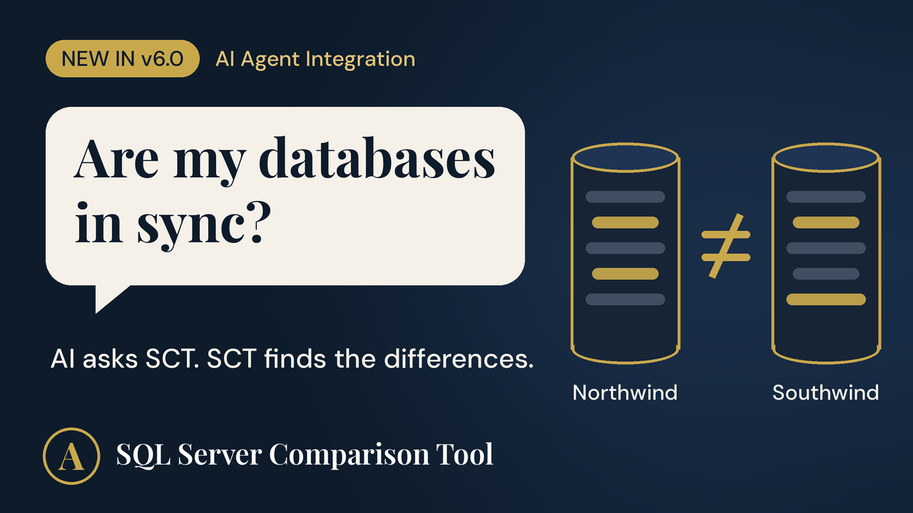

# SQL Server Comparison Tool: MCP Server

**Ask your AI assistant whether two SQL Server databases are in sync.**

[](https://youtu.be/Jno8Svs-DTs)

[SQL Server Comparison Tool (SCT)](https://www.sql-server-tool.com/) compares SQL Server database schemas and data, and has been used by developers and DBAs since 1999. Version 6.0 adds an **MCP (Model Context Protocol) server**, so AI assistants such as Claude Desktop can run your saved comparisons and explain the differences in plain English.

```
You:     Are my Northwind and Southwind databases in sync?
Claude:  No. Running your saved "Northwind vs Southwind" comparison, I found
         tables that differ in structure, a table that exists only in
         Northwind, and the tables that are identical. Here are the details...
```

> **This repository contains documentation only.** SCT is commercial Windows software with a [free 30-day trial](https://www.sql-server-tool.com/sql-server-download.htm). The MCP server (`SctMcpServer.exe`) is installed together with SCT 6.0.

## Tools

| Tool | What it does |
| --- | --- |
| `list_saved_comparisons` | Lists the comparisons you have saved in SCT. |
| `run_comparison` | Runs one saved comparison and returns structured results: which objects differ, which exist in only one database, and which are identical. |

Example prompts:

- "Are our staging and production databases in sync?"
- "Run comparison 4 and summarize what changed."
- "Which tables exist in production but not in the test database?"

## Read-only by design

Connecting an AI agent to production databases should make any DBA careful. The integration is built so it can't cause damage, even if the AI misunderstands a request:

- **It can't change your databases.** Nothing in the integration writes to SQL Server. SCT only reads what it needs to compare.
- **It can't choose which servers to connect to.** It can only run comparisons you created and saved in SCT yourself.
- **It never sees your credentials.** Connection details stay in SCT on your computer, with passwords stored encrypted.
- **It doesn't see your data.** Data comparisons report counts of differing and missing rows, never the row contents.

To apply differences, you generate the update script in SCT, review it, and run it yourself.

## Requirements

- Windows 10 or 11 (.NET Framework 4.8, preinstalled on both)
- [SQL Server Comparison Tool 6.0](https://www.sql-server-tool.com/sql-server-download.htm) or later (free 30-day trial)
- [Claude Desktop](https://claude.ai/download) or another MCP client that supports stdio servers
- At least one comparison saved in SCT
- SQL Server 2005 through 2025, or Azure SQL

## Quick setup (Claude Desktop)

1. Install SCT 6.0 and save at least one comparison in it.
2. Quit Claude Desktop (system tray icon, then **Quit**).
3. Open `%APPDATA%\Claude\claude_desktop_config.json` in Notepad (create it if it doesn't exist) and add:

```json
{
  "mcpServers": {
    "SQL Server Comparison Tool": {
      "command": "C:\\Program Files (x86)\\SQL Server Comparison Tool\\SctMcpServer.exe"
    }
  }
}
```

4. Start Claude Desktop and ask: *"List my saved database comparisons."*

Adjust the path if SCT is installed elsewhere. The double backslashes are required by JSON.

Full instructions, configuration settings and troubleshooting: **[Setup guide](docs/setup-guide.md)** (also on the [SCT website](https://www.sql-server-tool.com/ai-integration-setup.htm)).

## How it works

```
You  ->  Claude Desktop  ->  SctMcpServer.exe  ->  sct.exe  ->  SQL Server
                   (MCP, JSON-RPC over stdio)     (runs your saved comparison locally)
```

`SctMcpServer.exe` is a small .NET Framework 4.8 program with no third-party dependencies. When the AI calls a tool, it runs SCT's comparison engine in the background and returns the results as structured JSON, which the AI then explains to you.

## Links

- Website: https://www.sql-server-tool.com/
- Demo video: https://youtu.be/Jno8Svs-DTs
- Overview article: [Ask Your AI Whether Your SQL Server Databases Are in Sync](https://www.sql-server-tool.com/blog-ai-agent-integration.htm)
- Setup guide: [docs/setup-guide.md](docs/setup-guide.md)
- Support: [contact form](https://www.sql-server-tool.com/sql-server-contact.htm)

## About

SQL Server Comparison Tool is developed by AlfaAlfa Software Corporation, Toronto, Canada, since 1999.
